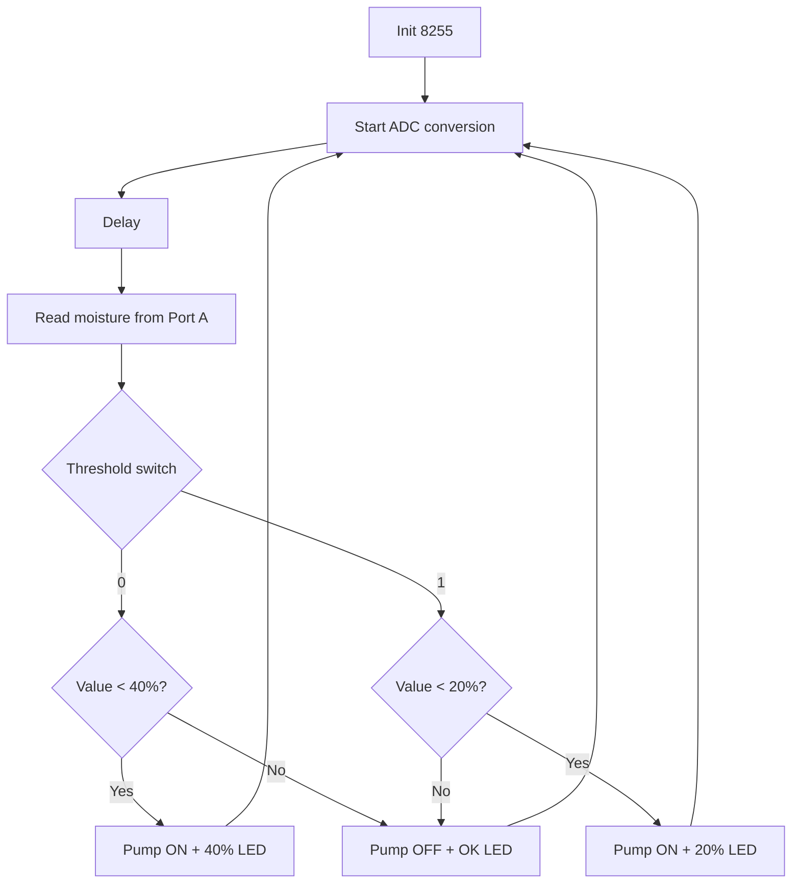
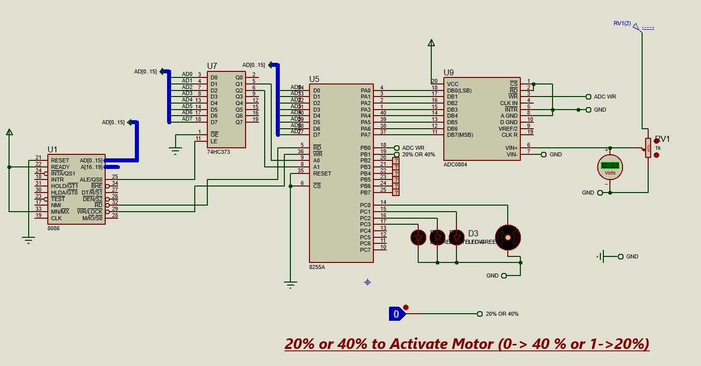

[← Back to all projects](https://github.com/abolfazljalil2003/proteus-projects)

# 8086 Smart Irrigation Controller

An automatic irrigation system built around the **Intel 8086** microprocessor, an **8255A PPI** and an **ADC0804** analog-to-digital converter, written in **8086 Assembly** and simulated in **Proteus**.

The system periodically reads the soil-moisture level and turns the water pump on when moisture falls below a selectable threshold (**20%** or **40%**).


## Features

- Analog moisture reading through an 8-bit ADC (ADC0804)
- Two selectable dry-soil thresholds using a switch: **40%** or **20%**
- Automatic pump (DC motor) control
- Status LEDs for "moisture OK" and for which threshold triggered the pump
- I/O through a programmable peripheral interface (8255A) with simple address decoding

## How it works

1. A potentiometer simulates the moisture sensor; its voltage goes to the ADC0804 input (a voltmeter shows the value).
2. The 8086 starts a conversion by toggling the ADC `WR` pin through port B of the 8255.
3. The 8-bit result is read from port A and compared with the selected threshold:
   - Switch = `0` → threshold **40%** (`66h` = 102 / 255)
   - Switch = `1` → threshold **20%** (`33h` = 51 / 255)
4. If the moisture is below the threshold, the pump turns on together with the LED for that mode; otherwise the pump is off and the "OK" LED is on.
5. The cycle repeats with a software delay between readings.



## Hardware

| Component | Role |
|---|---|
| 8086 | Main processor (minimum mode) |
| 74HC373 | Address latch (demultiplexes AD0–AD7) |
| 8255A | Programmable I/O interface |
| ADC0804 | 8-bit analog-to-digital converter |
| Potentiometer (1k) | Simulated moisture sensor |
| DC motor | Water pump |
| LEDs | Status indicators |
| Logic state | Threshold selector (20% / 40%) |

## I/O map

The 8255 `A0` and `A1` pins are connected to address lines `A1` and `A2`, so the ports sit at even addresses:

| Port | Address | Direction | Usage |
|---|---|---|---|
| Port A | `00h` | Input | ADC data (DB0–DB7) |
| Port B | `02h` | Output | PB0 → ADC `WR` (start conversion), PB1 ← threshold switch |
| Port C | `04h` | Output | PC0 → pump, PC1 → OK LED, PC2 → 40% LED, PC3 → 20% LED |
| Control | `06h` | — | Control word `90h` (Mode 0) |

## Output codes (Port C)

| Condition | Port C value | Result |
|---|---|---|
| Moisture OK | `00000010b` | OK LED on, pump off |
| Dry (40% mode) | `00000101b` | Pump on + 40% LED |
| Dry (20% mode) | `00001001b` | Pump on + 20% LED |

## Folder structure

```
8086-smart-irrigation/
├── simulation/   Proteus project file (.pdsprj)
├── src/          8086 assembly source (.asm)
├── docs/         Schematic image and demo GIF
└── README.md
```

## How to run

1. Assemble `src/main.asm` with **emu8086** (or MASM/TASM) to get a binary file.
2. Open `simulation/*.pdsprj` in **Proteus 8**.
3. Double-click the 8086 and set the binary as its **Program File**.
4. Press **Play**, turn the potentiometer and toggle the threshold switch.

## Schematic



## Tools

Proteus 8 · 8086 Assembly · emu8086
