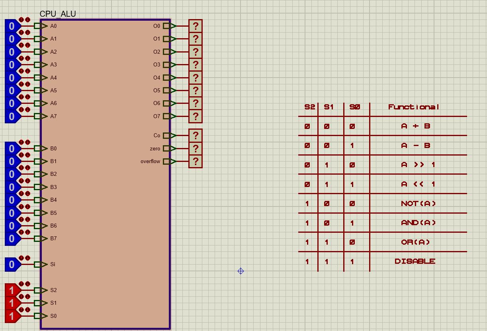

[← Back to all projects](../README.md)

# 8-Bit CPU Building Blocks from Logic Gates

The core building blocks of an 8-bit CPU — an **ALU**, **registers** and **memory cells** — designed from basic logic gates (AND, OR, NOT, NAND, XOR) and simulated in **Proteus**.

No microcontroller and no ready-made arithmetic ICs: every adder, shifter, decoder and memory bit is built gate by gate and organized as a hierarchy of reusable sub-circuits.


## Features

- **8-bit ALU** with 7 operations plus a disable state
- **Zero** and **overflow** flags
- 8-bit **ripple-carry adder** built from 8 full adders
- Subtraction using two's complement (XOR on B + carry in)
- **8-bit registers** with *set* and *enable* control lines
- **1-bit memory cells** (latches) made from NAND gates
- Fully **hierarchical design**: each block is a Proteus sub-circuit reused across the project

## ALU operations

| S2 S1 S0 | Operation |
|---|---|
| 000 | A + B |
| 001 | A − B |
| 010 | A >> 1 (shift right) |
| 011 | A << 1 (shift left) |
| 100 | NOT A |
| 101 | A AND B |
| 110 | A OR B |
| 111 | Disable (no output) |

A 3-to-8 decoder turns the select lines into one active line, and an **enabler** for each unit lets only the selected result reach the output.

## Inputs and outputs

| Signal | Type | Description |
|---|---|---|
| A0–A7 | Input | Operand A |
| B0–B7 | Input | Operand B |
| S0–S2 | Input | Operation select |
| Si | Input | Carry / shift input |
| C0–C7 | Output | Result (logic probes) |
| zero | Output | High when the result is 0 |
| overflow | Output | High when the result doesn't fit in 8 bits |

## Design hierarchy

```
CPU_ALU                     8-bit arithmetic logic unit
├── DEC-3X8                 Operation decoder
├── CPU_ADDER_8             8-bit ripple-carry adder
│   └── CPU_ADDER_1…8       Full adders
│       └── XOR_1           XOR built from basic gates
├── CPU_SHR / CPU_SHL       Shift right / shift left
├── CPU_NOT / CPU_AND / CPU_OR
├── CPU_ENABLE              Output enablers (one per unit)
└── Zero detector           8-input NOR (4078)

CPU_REG                     8-bit register (I0–I7, set, enable)
├── CPU_MEM_8               1-byte memory
│   └── CPU_MEM_1 × 8       1-bit memory cell (NAND latch)
└── CPU_ENABLE              Output enabler
```

## How the main blocks work

**Memory bit:** a latch made of NAND gates. While *set* is high the cell copies its input; when *set* goes low it keeps the last value.

**Register:** eight memory bits share one *set* line, so a whole byte is stored at once. An enabler (8 AND gates) puts the stored byte on the output only when *enable* is high, so several registers can share one bus.

**Adder:** each full adder computes `sum = A ⊕ B ⊕ Cin` and `Cout = AB + Cin(A ⊕ B)`. Eight of them are chained so each carry feeds the next bit.

**Subtraction:** `A − B = A + (NOT B) + 1`. B is passed through XOR gates to invert it and the extra 1 enters as the carry in.

**Shifters:** pure wiring. Each bit moves one position left or right, and the empty bit is filled from the shift input.

**Zero flag:** all 8 result bits go into an 8-input NOR gate, which outputs 1 only when every bit is 0.

## Folder structure

```
8bit-cpu-logic-gates/
├── simulation/   Proteus project (CPU.pdsprj)
├── docs/         Schematic images and demo GIF
└── README.md
```

## How to run

1. Open `simulation/CPU.pdsprj` in **Proteus 8.17** or newer.
2. Press **Play**.
3. Set operands A and B and the operation code with the logic-state switches.
4. Read the result and flags on the logic probes. Double-click a sub-circuit to go inside it and see its gates.

## Schematics




## Tools

Proteus 8 · Digital logic design
