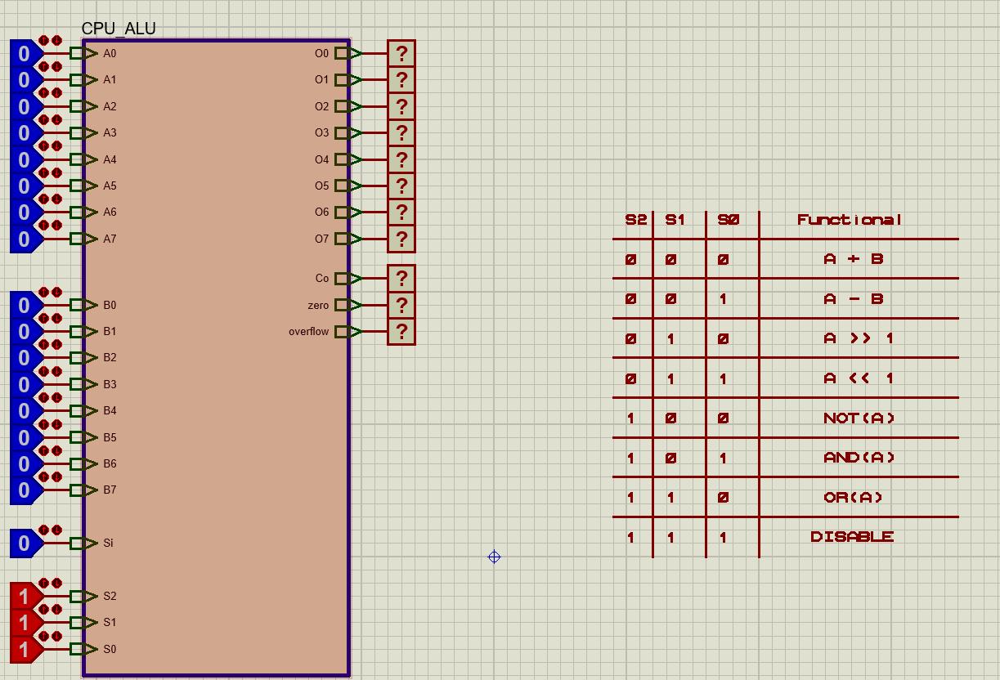
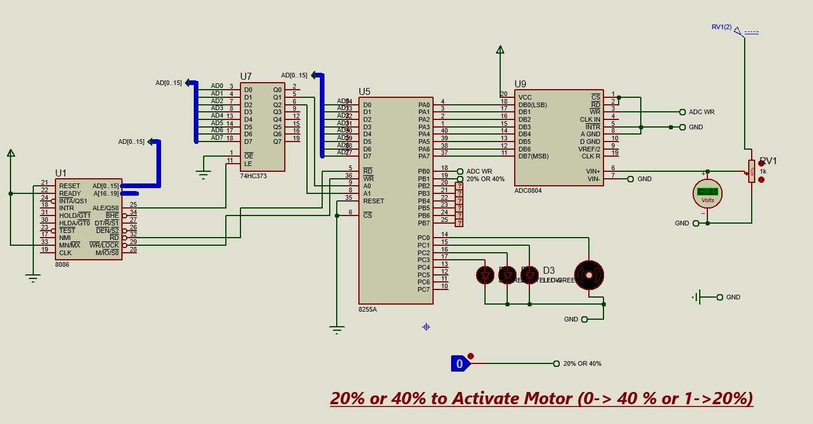
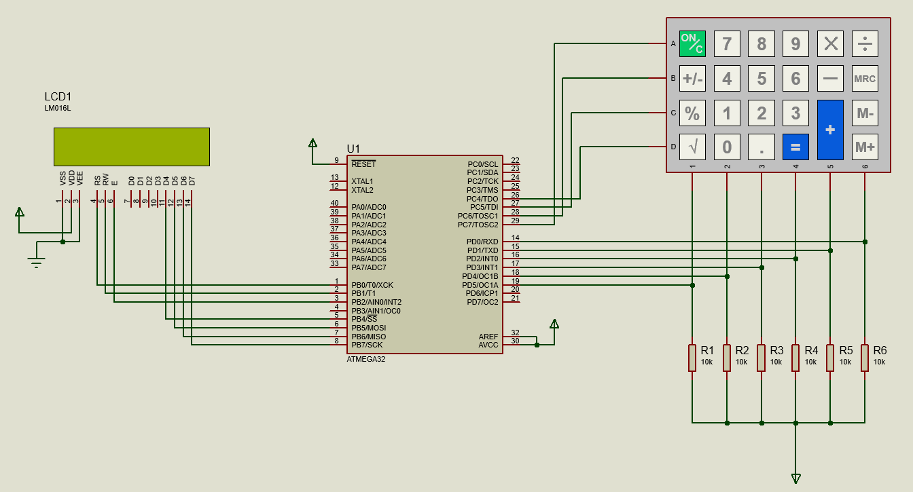

# Proteus Projects


A collection of embedded systems and digital design projects, all designed and simulated in **Proteus**.
The projects cover three levels of computer hardware: building a CPU's core blocks from **logic gates**, programming a classic **8086 microprocessor** in Assembly, and writing firmware for a modern **AVR microcontroller** in C.

Each project has its own folder with the simulation file, source code, schematics and a detailed README.

## Projects

### [8-Bit CPU Building Blocks](8bit-cpu-logic-gates/)



An 8-bit ALU, registers and memory cells built entirely from basic logic gates, organized as a hierarchy of reusable sub-circuits.

- 7 ALU operations (add, subtract, shift left/right, NOT, AND, OR) with zero and overflow flags
- Ripple-carry adder from 8 full adders, two's-complement subtraction
- 8-bit registers made of NAND-gate memory cells with set/enable control

**Built with:** logic gates only · Proteus

---

### [8086 Smart Irrigation Controller](8086-smart-irrigation/)



An automatic irrigation system that reads soil moisture and turns on a water pump when the soil is too dry.

- Moisture reading through an ADC0804, interfaced via an 8255A PPI
- Selectable dry-soil threshold: 20% or 40%
- Pump control and status LEDs

**Built with:** 8086 · 8255A · ADC0804 · 74HC373 · Assembly

---

### [ATmega32 Scientific Calculator](atmega32-calculator/)



A keypad calculator on a 16×2 LCD with scientific functions, written without the standard math library.

- Chained operations, powers (x^y), square root (Newton–Raphson) and percentage
- 10-slot memory with M+, M− and MRC
- Matrix keypad scanning and Timer0-based delays

**Built with:** ATmega32 · LM016L LCD · 4×6 keypad · C (CodeVisionAVR)

## Skills demonstrated

| Area | Topics |
|---|---|
| Digital logic | Combinational and sequential circuits, adders, decoders, latches, registers, hierarchical design |
| Microprocessors | 8086 bus demultiplexing, I/O-mapped peripherals, 8255A programming, ADC interfacing |
| Microcontrollers | AVR I/O ports, timers, keypad scanning, character LCD, embedded C |
| Algorithms | Newton–Raphson square root, float-to-string conversion, threshold control |
| Tools | Proteus simulation, emu8086, CodeVisionAVR |

## Repository structure

```
proteus-projects/
├── 8bit-cpu-logic-gates/
├── 8086-smart-irrigation/
├── atmega32-calculator/
└── README.md
```

Each project folder follows the same layout:

```
project-name/
├── Proteus project (.pdsprj)
├── Source code (and compiled binary)
├── docs/         Schematics and demo GIF
└── README.md
```

## Running a project

1. Install **Proteus 8.17** or newer.
2. Open the `.pdsprj` file from the project's `simulation` folder.
3. For processor-based projects, make sure the processor's **Program File** points to the binary in the project folder.
4. Press **Play**.

Details for building the source code are in each project's README.

## Contact
**Abolfazl Jalil S.**
 
[Email](mailto:abolfazljalil6@gmail.com)

