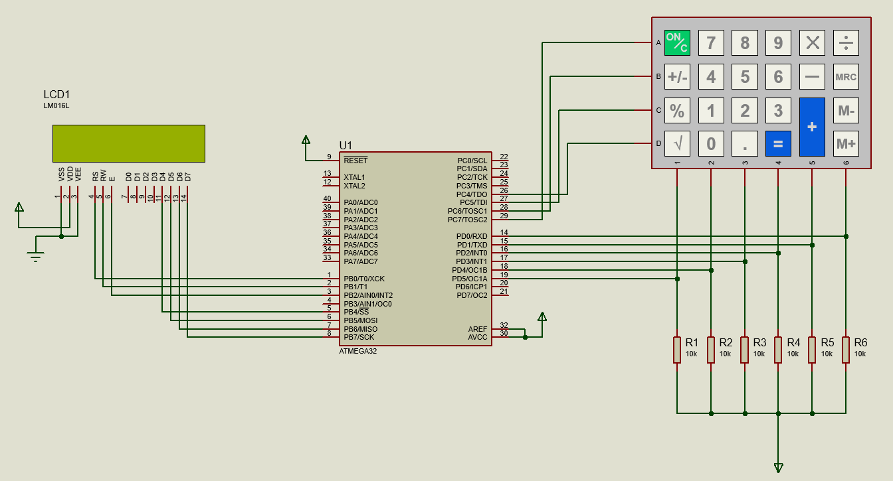

[← Back to all projects](../README.md)

# ATmega32 Scientific Calculator

A keypad calculator built with an **ATmega32** microcontroller, a **4×6 calculator keypad** and a **16×2 character LCD**, written in **C (CodeVisionAVR)** and simulated in **Proteus**.

Beyond the four basic operations it supports chained calculations, powers, square roots, percentages and a 10-slot memory, all implemented without the standard math library.


## Features

- Addition, subtraction, multiplication and division with decimal numbers
- Chained operations (`2 + 3 × 4 =` evaluates step by step)
- Power operation: press `×` twice for **x^y** mode
- Square root using the **Newton–Raphson** method
- Percentage and sign change (`+/-`)
- **10-slot memory**: `M+` stores a value, `M-` removes a matching value, `MRC` recalls the last stored value
- `ON/C` turns the display on and off and resets the calculator
- Error messages for division by zero, square root of a negative number, and full or empty memory
- Custom float-to-string conversion (avoids the large `printf` float library)
- Millisecond delay generated with **Timer0** instead of busy loops

## Hardware

| Component | Role |
|---|---|
| ATmega32 (internal 1 MHz clock) | Main controller |
| LM016L (16×2 LCD) | Display |
| KEYPAD-CALCULATOR (4×6) | User input |
| 6 × 10k resistors | Pull-ups for the keypad input lines |

## Pin map

| Port | Pins | Connected to |
|---|---|---|
| PORTB | PB0–PB7 | LCD (CodeVision LCD library, `__lcd_port = PORTB`) |
| PORTC | PC4–PC7 | Keypad scan lines (driven low one at a time) |
| PORTD | PD0–PD5 | Keypad return lines (read, with 10k pull-ups) |

## Keypad layout

| | 1 | 2 | 3 | 4 | 5 | 6 |
|---|---|---|---|---|---|---|
| **A** | ON/C | 7 | 8 | 9 | × | ÷ |
| **B** | +/- | 4 | 5 | 6 | − | MRC |
| **C** | % | 1 | 2 | 3 | + | M− |
| **D** | √ | 0 | . | = | + | M+ |

The `+` key is a double-height key covering rows C and D.

## How it works

**Keypad scanning:** the program pulls one scan line on PORTC low at a time and reads PD0–PD5. Because of the pull-ups, a pressed key shows up as a single `0` bit. The scan line and the bit position are looked up in a 4×6 table to get the key code.

**Number entry:** digits build up the current value (`value × 10 + digit`). After `.` is pressed, each new digit is added as `digit / 10^n`.

**Operations:** when an operator is pressed, the current value is stored as the first operand. If an operator was already pending, the previous result is calculated first, which allows chained calculations. `=` performs the final calculation and shows `Result:` on the first line.

**Math functions:** square root uses Newton–Raphson iteration (`x(n+1) = (x(n) + a / x(n)) / 2`) until the change is below `0.00001`. Powers use repeated multiplication for the integer part of the exponent and square roots for fractional parts of .25, .5 and .75.

**Delay:** Timer0 runs with a prescaler of 64 and is preloaded with 240, so each overflow takes 16 × 64 = 1024 cycles, about 1 ms at 1 MHz.

## Folder structure

```
atmega32-calculator/
├── simulation/   Proteus project (.pdsprj)
├── firmware/     C source (main.c) and compiled .hex
├── docs/         Schematic and demo GIF
└── README.md
```

## How to run

1. Open `simulation/MicroLab_FinalProject.pdsprj` in **Proteus 8.17** or newer.
2. Double-click the ATmega32 and set **Program File** to `firmware/final_project.hex`.
3. Press **Play**, then press `ON/C` on the keypad to turn the calculator on.

To rebuild the firmware, open `firmware/main.c` in **CodeVisionAVR** with the ATmega32 selected at 1 MHz and build the project.

## Known limitations

- Displayed integer part is limited to ±32767 (16-bit `int` conversion).
- Holding a key down repeats it, because the scan routine doesn't wait for the key to be released.
- The delete-last-digit function exists in the code but isn't mapped to a key yet.

## Schematic



## Tools

Proteus 8 · CodeVisionAVR · C
